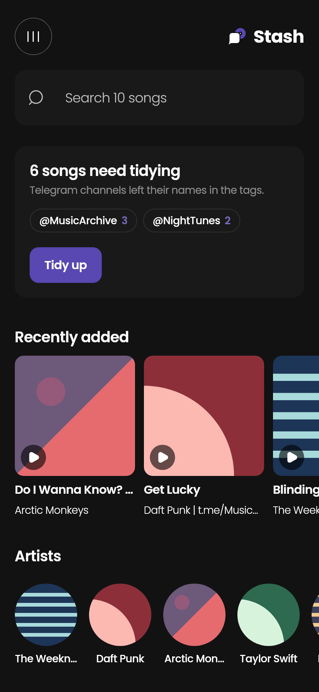
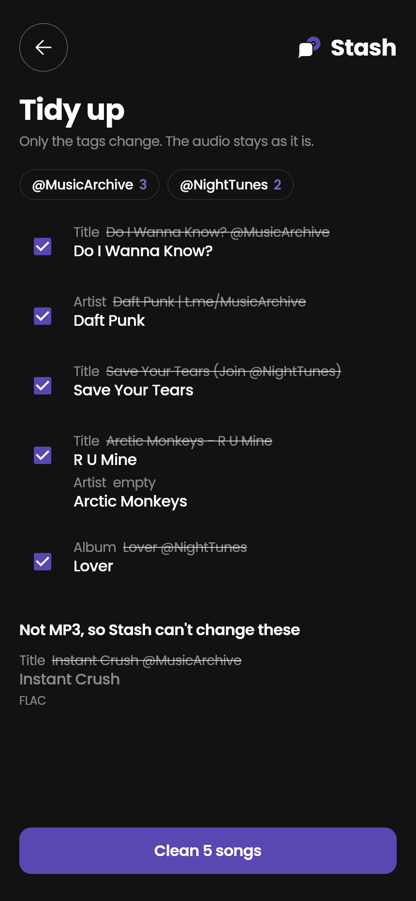
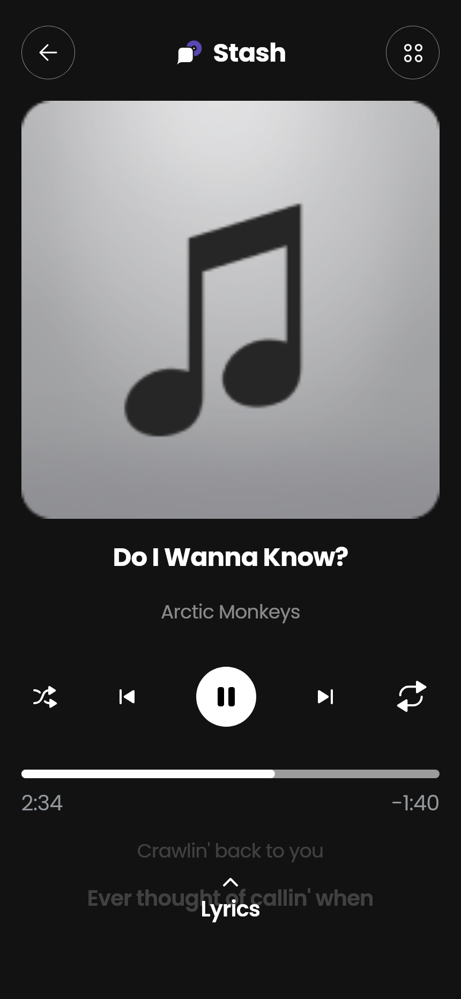
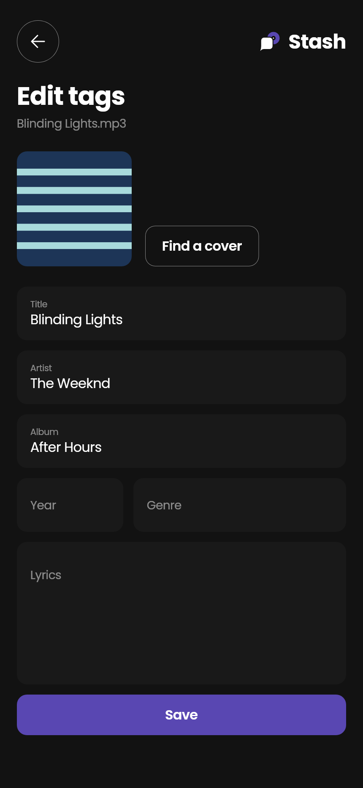
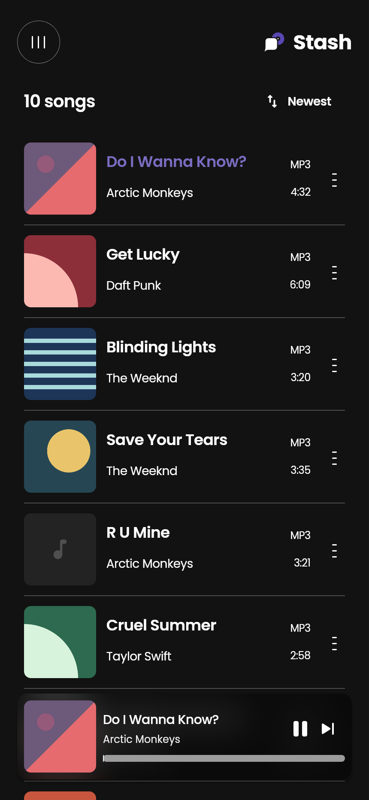
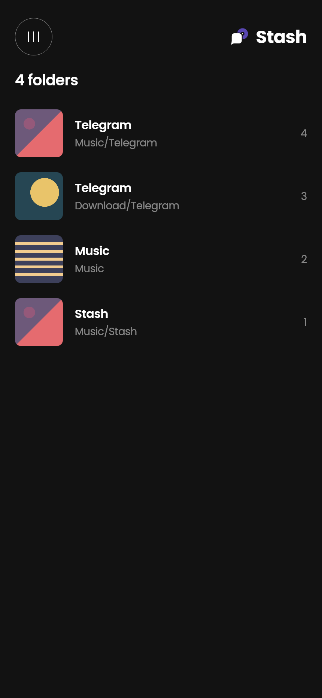
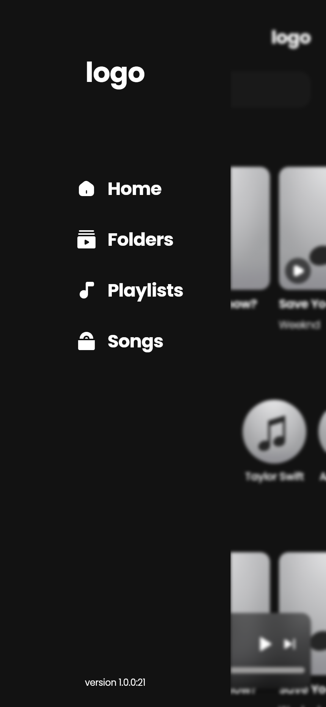

<p align="center">
  
</p>

<h1 align="center">Stash</h1>

<p align="center">
  <b>All the music you saved on Telegram, in one player.</b><br>
  A free Android music player for the songs you collect on Telegram:<br>
  play them, fix their messy tags, find album covers and add lyrics.
</p>

<p align="center">
  <a href="https://github.com/SalehTZ/Stash/releases"></a>
  <a href="#support-stash"></a>
</p>

<p align="center">
  <a href="https://apps.obtainium.imranr.dev/redirect?r=obtainium://app/%7B%22id%22%3A%22ir.salehtz.stash%22%2C%22url%22%3A%22https%3A%2F%2Fgithub.com%2FSalehTZ%2FStash%22%2C%22author%22%3A%22SalehTZ%22%2C%22name%22%3A%22Stash%22%7D"></a>
</p>

<p align="center">
  <a href="https://github.com/SalehTZ/Stash/stargazers"></a>
  <a href="https://github.com/SalehTZ/Stash/releases"></a>
  <a href="https://github.com/SalehTZ/Stash/actions/workflows/ci.yml"></a>
</p>

<p align="center">
  
  
  
  
</p>
<p align="center">
  
  
  
</p>
<p align="center"><sub>Screenshots from a demo library.</sub></p>

---

## Why Stash?

Telegram is where a lot of us find music: channels, groups, friends sending
songs. But those files arrive with the channel's name stamped into them
(`Song @SomeChannel`, `Artist | t.me/somechannel`, `Album (Join @channel)`),
or with no tags at all and a file name like `Artist - Title.mp3`. Stash plays
them and cleans them up.

- **Tidy up.** Stash finds every song with a channel stamp, shows each tag
  before and after, and cleans them all after one OK from Android. Files with
  no artist named `Artist - Title` are split into the two.
- **Tag editor.** Title, artist, album, year, genre, lyrics and cover. Stash
  writes ID3v2.3 and v2.4 itself and keeps the frames it doesn't know about.
  When the new tag fits in the old one's space, only the tag is written and
  the audio is never touched.
- **Covers and lyrics.** Find a cover on iTunes or Deezer, and lyrics on
  LRCLIB, time-synced line by line when it has them. Save either into the
  song.
- **Share to Stash.** In Telegram, share a song to Stash and it's saved to
  `Music/Stash`, out of Telegram's private folder.
- **A real player.** Background playback with notification and lock-screen
  controls, shuffle, repeat, play next, favorites, playlists, recently played
  and added, artists, folders and search.

Not yet: changing the tags of M4A, FLAC or OGG files. Stash shows them and
plays them, and tells you when it can't change one.

### Privacy

Stash has no account, no ads and no analytics. It only goes online when you
search for a cover or lyrics, and then it sends the song's title and artist to
iTunes, Deezer or LRCLIB.

## Download

Grab the latest build from **[Releases](https://github.com/SalehTZ/Stash/releases)**:

| Platform | File |
|---|---|
| Android | `stash-android-arm64-v8a.apk` (most phones), `armeabi-v7a` for older ones, `x86_64` for emulators and Chromebooks |

On Android, **[add Stash to Obtainium](https://apps.obtainium.imranr.dev/redirect?r=obtainium://app/%7B%22id%22%3A%22ir.salehtz.stash%22%2C%22url%22%3A%22https%3A%2F%2Fgithub.com%2FSalehTZ%2FStash%22%2C%22author%22%3A%22SalehTZ%22%2C%22name%22%3A%22Stash%22%7D)** to get updates straight from these releases.

If you installed **v0.1.0**, uninstall it. That preview was still called Telegram
Music Player and Android sees it as a different app, so Stash won't replace it.

<details>
<summary>Verify that an APK is really from us</summary>

Every official Android release is signed with the same key as
[Snag](https://github.com/SalehTZ/snag). Check it with `apksigner` (from the
Android SDK build-tools):

```bash
apksigner verify --print-certs stash-android-*.apk
```

The `SHA-256` digest must be:

```
A5:35:0A:AA:8A:BC:94:6C:C8:68:36:B7:70:F6:61:70:D3:EF:C2:AE:7E:6C:15:B3:DD:0A:3C:E6:A6:AA:13:8D
```

If it doesn't match, don't install it. An APK signed with a different key also
can't update an existing install. Each release also lists the files' checksums
in `SHA256SUMS.txt`.
</details>

## Support Stash

Stash is free and always will be: no ads, no paywalls, no "pro"
version. If you like it, please consider chipping in. Donations pay for the
hours that go into building it and keep it free for everyone.

<a href="https://github.com/sponsors/SalehTZ"></a>

**Crypto**, listed cheapest network first. Send only on the network shown; coins
sent on a different network can be lost for good.

| Network | On exchanges, pick | Send | Address |
|---|---|---|---|
| **BNB Smart Chain** (lowest fees) | `BSC` / `BEP20` | BNB, USDT | `0xDc131f09a194957EAdD1c069765BF9e78013Ac8C` |
| **Tron** | `TRON` / `TRC20` | TRX, USDT | `TPmJbZpicJEaG9Vj5sMLBmKvzMnyn7Bkxt` |
| **Ethereum** | `ETH` / `ERC20` | ETH, USDT | `0xDc131f09a194957EAdD1c069765BF9e78013Ac8C` |
| **Bitcoin** | `BTC` (SegWit, address starts with `bc1`) | BTC | `bc1qahd3arfp90rpny73dp9unjhcdl32mmnkrln7uy` |

<details>
<summary>Which network should I use?</summary>

- **BNB Smart Chain (BSC, BEP20)**: Binance's network. The cheapest here, usually a few cents. Not the same as "BNB Beacon Chain" or "opBNB".
- **Tron (TRC20)**: the most widely supported network for USDT, especially on Iranian exchanges. Sending USDT costs around $1 unless your wallet has staked TRX.
- **Ethereum (ERC20)**: the original smart-contract network. Often cheap lately, but fees can jump when it's busy.
- **Bitcoin**: the original. Fees vary with network load, and it's slower than the others.

The BNB Smart Chain and Ethereum addresses are the same. That's normal: both networks use the same address format. Just make sure the network you pick matches the row you're copying from.
</details>

You can also help for free:
- ⭐ **Star the repo.** It helps other people find the app.
- 🐛 **[Report bugs](https://github.com/SalehTZ/Stash/issues)** and suggest features.
- 📥 **Try [Snag](https://github.com/SalehTZ/snag)**, my free video and audio downloader.

## Where the songs come from

Telegram keeps its downloads in `Android/data/org.telegram.messenger/`, and
since Android 11 no other app can read that folder. To bring a song over:

- in Telegram, open the song's menu and tap **Save to Music** (it lands in
  `Music/Telegram`) or **Save to Downloads** (`Download/Telegram`), or
- **share** the song to Stash, which saves it to `Music/Stash`.

Stash reads them through Android's media library, so it only asks for
**Music and audio**. Android 11 and later also ask once before Stash changes
files another app saved, like Telegram's; Stash asks for all the songs of a
tidy-up together.

## Build it yourself

You need [Flutter 3.16](https://docs.flutter.dev/release/archive) (the version
`pubspec.lock` was made with), the Android SDK and Java 17.

```sh
git clone https://github.com/SalehTZ/Stash.git
cd Stash
flutter pub get
flutter run

# Release build, one APK per CPU type
flutter build apk --release --split-per-abi
```

Run the checks that CI runs:

```sh
dart format --output=none --set-exit-if-changed lib test
flutter analyze
flutter test
```

To update the screenshots after changing the UI:

```sh
flutter test test/screenshots_test.dart --dart-define=SCREENSHOT_DIR=docs/screenshots
```

### Project structure

```text
lib/
  main.dart                 entry point, background playback setup
  src/
    app.dart                MaterialApp, theme and the library and player cubits
    blocs/
      library/              songs, favorites, history, playlists, tidy-up
      player/               playback on just_audio
    constants/              colors, fonts, text styles, sizes and asset paths
    data/
      library/              the phone's media library, covers, saved state
      tags/                 ID3 reader and writer, channel stamp cleaner
      lyrics/               LRC and plain lyrics
      online/               cover (iTunes, Deezer) and lyrics (LRCLIB) search
    presentation/
      screens/              home, songs, folders, playlists, player, lyrics,
                            tag editor, cover search and tidy-up
      widgets/              reusable widgets
    utils/                  small helpers
android/app/src/main/java/  MainActivity: media library, file writes, sharing
assets/
  fonts/                    Poppins
  icons/                    SVG icons exported from the design
test/
  support/                  a demo library and a fake player for tests
```

## Releases

Two GitHub Actions workflows build the app:

- **CI** (`.github/workflows/ci.yml`) runs on every push and pull request: it
  checks formatting, analyzes, runs the tests and builds one APK per CPU type,
  which you can download from the run for 14 days.
- **Release** (`.github/workflows/release.yml`) runs when a version tag is
  pushed. It builds one APK per CPU type, checks that each one is signed with
  the release key above, and publishes them with `SHA256SUMS.txt` as a GitHub
  release.

To publish a release:

```sh
git tag v0.2.0
git push origin v0.2.0
```

The version name comes from the tag and the version code from the workflow run
number.

### Release signing

Releases are signed with the same key as Snag, using the same repository
secrets (**Settings → Secrets and variables → Actions**). Copy the values from
Snag's secrets:

| Secret | Value |
| --- | --- |
| `ANDROID_KEYSTORE_BASE64` | the keystore file, base64-encoded |
| `ANDROID_KEYSTORE_PASSWORD` | the keystore password (also used as the key password) |
| `ANDROID_KEY_ALIAS` | the key alias |

Without them, or with a different key, the release workflow fails instead of
publishing an APK that can't update existing installs.

To sign release builds on your own machine, create `android/key.properties`
(it's git-ignored):

```properties
storeFile=/absolute/path/to/release.jks
storePassword=...
keyPassword=...
keyAlias=...
```

Without that file, release builds use the debug key, which is fine for testing.

## Credits

- The UI follows the project's Figma design.
- Covers from the [iTunes Search API](https://performance-partners.apple.com/search-api)
  and the [Deezer API](https://developers.deezer.com/api), lyrics from
  [LRCLIB](https://lrclib.net).
- [Poppins](https://github.com/itfoundry/Poppins) font, licensed under the SIL
  Open Font License 1.1 (see `assets/fonts/Poppins-OFL.txt`).
